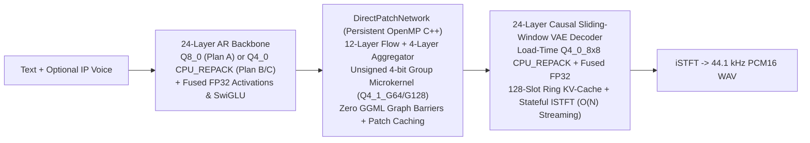

# Ming-3.0-TTS 0.5B Real-Time x86 CPU Optimization (`RTF < 1.0`)

[English](README.md) | [中文说明](README_ZH.md) | [▶ Online A/B Audio Demo](https://robotse7en.github.io/ming3-tts-cpu-realtime/) | [Full Experiment Log](docs/experiments.md)

Achieving **real-time (`RTF 0.79–0.99`)** neural TTS synthesis for **Ming-3.0-TTS 0.5B** on a 6-year-old 4-core desktop CPU (**Intel Core i3-10100 @ 3.60 GHz** inside a TrueNAS Linux VM, 4 threads, no discrete GPU, no iGPU passthrough) — using the **existing official `Q8_0` GGUF checkpoint** with load-time weight repacking (~2.3s), zero swap, and up to **46% lower peak RAM**.

Built as a clean, replayable patch and C++ AVX2 microkernel suite on top of [`0xShug0/audio.cpp`](https://github.com/0xShug0/audio.cpp) (`7d20b414`, Apache 2.0) without modifying the upstream checkout.

---

## Headline ABBA Benchmark Results

All benchmarks use sequential **ABBA** blocks (`baseline → fast → fast → baseline`, 1 warmup + 2 runs/block = 4 measured runs/variant) under identical `systemd-run` limits (**4 threads, `CPUQuota=400%`, `MemoryMax=6G`, `MemorySwapMax=0`**). Repeated runs are bitwise-deterministic (verified via WAV SHA-256).

### 1. Operating Modes Comparison (Same Binary, Same `Q8_0` GGUF)

| Mode | Short (4s) | Long (18–22s) | `灵小柔` (6s) | Peak RAM | Highlight |
| --- | ---: | ---: | ---: | ---: | --- |
| **Baseline** (`Q8_0`) | `1.72–1.82` | `1.97–2.08` | `1.92` | `1.98 GiB` | Upstream reference |
| **Plan A** ⭐ | **`0.84`** (2.06×) | **`0.99`** (2.10×) | **`0.97`** (1.98×) | **`1.23 GiB`** (-38%) | **Recommended** · Best audio fidelity |
| **Plan B** | **`0.79`** (2.18×) | **`0.87`** (2.25×) | **`0.87`**\* | **`1.09 GiB`** (-45%) | Max speed & lowest memory |
| **Plan C** | **`0.89`** (2.05×) | **`0.99`** (2.01×) | — | **`1.07 GiB`** (-46%) | Exact official 10-step schedule |

- **Plan A (Recommended — High Quality)**: `AR=q8` (`--fused-fp32-act auto`, keeping AR's upstream BF16 rounding intact) + `Flow/Agg=q4g128` (8-step sway, full CFG=2.0 on every step) + `VAE=q4_0`. Passes automated screening on both `灵小柔` 30-char (**`0.9337`** cosine, `CER=0.0000`) and 107-char (**`0.9383`** cosine, `review_flag=false`), with direct audio inspection confirming no chunk-2 robotic artifact (listen online below). *(Optional `--ar-quant iq4_nl --fused-fp32-act 0 --flow-quant q4g64` measured `灵小柔` 30c/107c at `0.89`/`0.93` with `1.11 GiB` RAM without `Q4_0` metallic buzz.)*
- **Plan B (Fastest / Lowest RAM)**: `AR=q4_0` + `Flow/Agg=q4g64` (8-step sway, full CFG) + `VAE=q4_0`. Maximum RTF margin and lowest memory; `0.0000` clipping (*`灵小柔` 30-char is single-run: `CER=0.0000`, cosine `0.8501`).
- **Plan C (Exact 10-Step)**: `AR=q4_0` + `Flow/Agg=q4g128` (official 10-step, full CFG) + `VAE=q4_0`. Zero sampling schedule changes.

### 2. Plan A (`AR=q8` BF16 + `Flow=q4g128`) Detailed ABBA & Screening

| Fixture | Baseline | Plan A | Speedup | Peak RAM | CER / Cosine |
| --- | ---: | ---: | ---: | ---: | ---: |
| `zh_short` (3.9s) | `1.740` | **`0.844`** | **2.06×** | `1.33 → 1.22 GiB` | `0.00` / `0.785` |
| `zh_paragraph` (17.7s) | `2.079` | **`0.991`** | **2.10×** | `1.98 → 1.23 GiB` | `0.04` / `0.709` |
| `灵小柔` 30c (6.0s) | `1.921` | **`0.972`** | **1.98×** | `1.35 → 1.22 GiB` | `0.00` / **`0.934`** ✓ |
| `灵小柔` 107c (17.9s)¹ | `2.141` | `1.120`¹ | **1.91×** | `1.97 → 1.27 GiB` | `0.01` / **`0.938`** ✓ |

<details>
<summary>Full 4-run RTF distributions, clipping stats, and extra regression fixtures</summary>

| Fixture | Baseline | Plan A | Plan A 4 Runs | Base → Plan A CER | Clipping |
| --- | ---: | ---: | --- | ---: | ---: |
| `zh_short.txt` | `1.7403` | `0.8442` | `0.8238, 0.8539, 0.8344, 0.8596` | `0.0000 → 0.0000` | `0.000000` |
| `zh_paragraph.txt` | `2.0794` | `0.9908` | `1.0149, 1.0318, 0.9668, 0.9512` | `0.0625 → 0.0417` | `0.000005` |
| `zh_lingxiaorou_short.txt` | `1.9209` | `0.9724` | `0.9808, 0.9684, 0.9570, 0.9764` | `0.0000 → 0.0000` | `0.000000` |
| `zh_paragraph.txt` (`灵小柔`) | `2.1406` | `1.1200` | `1.1672, 1.2344, 1.0674, 1.0728` | `0.0000 → 0.0104` | `0.000000` |
| `zh_regression.txt` (1×) | `1.8157` | `0.8430` | `0.8430` (2.15×) | — | — |
| `zh_long_regression.txt` (1×) | `2.1915` | `0.9491` | `0.9491` (2.31×) | — | — |

</details>

> ¹ In pinned `audio.cpp` `7d20b414`, `灵小柔` is passed via `template_name=freeform` (bypassing the older English-only `voice_id` enum validator), which does not set `controls["ip"]` and therefore still triggers redundant chunk-1 voice anchoring on multi-chunk text plus ~55 extra JSON tokens per chunk (single quiet-host run measured `0.984`; ABBA saw host CPU load spike where baseline also rose from `2.02` to `2.14`).

Sanitized JSON reports for all ABBA runs and SenseVoice INT8 ASR + CAMPPlus quality screenings live in [`benchmarks/published_results/`](benchmarks/published_results/). Automated ASR/speaker metrics are screening tools, not a formal human MOS test.

---

## Audio Samples (A/B Comparisons)

> **▶ [Open Interactive Online A/B Player (Click-to-Play, No Download)](https://robotse7en.github.io/ming3-tts-cpu-realtime/)**
>
> GitHub README strips `<audio>` tags, so we host a zero-download browser A/B player on GitHub Pages alongside lossless 44.1 kHz WAV & waveform MP4 downloads in [Release `audio-samples`](https://github.com/RobotSe7en/ming3-tts-cpu-realtime/releases/tag/audio-samples).

| Sample | A: Baseline (`Q8_0`) | B: Plan A Real-Time | Summary |
| --- | --- | --- | --- |
| **1. `灵小柔` Short** (30c, 6s) | [WAV](https://github.com/RobotSe7en/ming3-tts-cpu-realtime/releases/download/audio-samples/01_lingxiaorou_30c_baseline_q8.wav) (`1.92`) | [WAV](https://github.com/RobotSe7en/ming3-tts-cpu-realtime/releases/download/audio-samples/01_lingxiaorou_30c_planA_ar_q8.wav) (**`0.97`**) · [A/B MP4](https://github.com/RobotSe7en/ming3-tts-cpu-realtime/releases/download/audio-samples/ab_demo_lingxiaorou_30c.mp4) | **1.98×** · Cos **`0.934`** ✓ |
| **2. `灵小柔` Long** (107c, 18s) | [WAV](https://github.com/RobotSe7en/ming3-tts-cpu-realtime/releases/download/audio-samples/02_lingxiaorou_107c_baseline_q8.wav) (`2.14`) | [WAV](https://github.com/RobotSe7en/ming3-tts-cpu-realtime/releases/download/audio-samples/02_lingxiaorou_107c_planA_ar_q8.wav) (`1.12`¹) · [A/B MP4](https://github.com/RobotSe7en/ming3-tts-cpu-realtime/releases/download/audio-samples/ab_demo_lingxiaorou_107c.mp4) | **1.91×** · Cos **`0.938`** ✓ |
| **3. Paragraph** (107c, 18s) | [WAV](https://github.com/RobotSe7en/ming3-tts-cpu-realtime/releases/download/audio-samples/03_uncond_107c_baseline_q8.wav) (`2.08`) | [WAV](https://github.com/RobotSe7en/ming3-tts-cpu-realtime/releases/download/audio-samples/03_uncond_107c_planA_ar_q8.wav) (**`0.99`**) · [A/B MP4](https://github.com/RobotSe7en/ming3-tts-cpu-realtime/releases/download/audio-samples/ab_demo_uncond_107c.mp4) | **2.10×** · RAM `-38%` |

All samples are unedited 44.1 kHz PCM16 outputs (`seed=1895`, 4 CPU threads, zero post-processing).

---

## Why Naive Tuning Fails: Hardware Roofline & Bottlenecks

Before writing kernels, we profiled stage timings and measured raw DRAM read bandwidth on this 4-core i3-10100 VM (AVX2/FMA/F16C, no AVX-512/VNNI):

- **Stage profile (4T `Q8_0` baseline)**: Flow sampling accounts for **68.4%** of total synthesis time (500 sequential `M=6` forward passes for 4s audio), AR decode/prefill **16.4%**, VAE decoder **10.7%**, Aggregator **4.3%**.
- **Measured 4-thread DDR4 read bandwidth**: **`25.35 GB/s`**.
- **Physical floor for unmodified `Q8_0` 10-step Flow**: Reading ~179 MB of `Q8_0` Flow weights 500 times transfers `89.3 GB`, requiring **`3.52 s` (`RTF ≥ 0.88`) for Flow DRAM reads alone** — plus ~`0.50 RTF` from AR + VAE + Aggregator, making `RTF ≤ 1.0` physically impossible under pure `Q8_0` 10-step full-CFG.
- **Why iGPU (Intel UHD 630) wouldn't help**: The VM exposes only a virtual QXL adapter (no `/dev/dri/renderD*`). Even with VFIO passthrough, UHD 630 (Gen9.5, 24 EU, no DP4A/XMX) shares the same `25.35 GB/s` DDR4 bus while adding GPU submission/sync latency to 500 tiny `M=6` sequential calls.

---

## Architecture & Key Optimizations



1. **Direct Persistent C++ Flow & Aggregator Engine** ([`src/ming_cpu/flow_engine.cpp`](src/ming_cpu/flow_engine.cpp)):
   - Replaces ~200 GGML graph nodes and barriers per step with a single persistent `#pragma omp parallel` region spanning all Flow steps of a patch.
   - Precomputes `time_mlp` per timestep; caches `cond_emb`, `hist_emb`, and Block-0 `hist_qkv` once per patch; shares Block-0 `x_emb` QKV across cond/uncond (3 rows instead of 6); precomputes Aggregator `cls_qkv` once at load.
   - Fuses `RMSNorm + BF16 + Quantize` in L1 stack buffers, fuses `RoPE + Multi-Head Attention + BF16`, fuses `bias + BF16 + residual/GELU LUT`, adds 4-channel unrolled AVX2 kernels for `M=1,2`, batches Aggregator (`chunk ≤ 3`), and caches repeated `prompt_latents` projections across chunks.
2. **Group-Quantized Unsigned 4-bit AVX2 Microkernel (`Q4_1_G64` / `Q4_1_G128`)**:
   - Packs each output channel into a single 32B-aligned contiguous slab (group size 64 or 128) with unsigned 4-bit nibbles, paired with a group-major `Q8GroupInputBuffer` that eliminates 4 KiB L1d set-aliasing on `in_features=4096`.
   - Inner loop uses `vpmaddubsw + vpaddw` with zero `vpsignb` overhead (worst-case 16-bit partial sum `15,240 < 32,767`, zero overflow), cutting 12-layer `M=6` Flow latency from ~8–9 ms/step down to ~3.6–4.1 ms/step.
   - All AVX2/FMA/F16C paths are runtime-gated via `__builtin_cpu_supports` with full portable scalar fallbacks and `Q8_0` compatibility.
3. **Load-Time `CPU_REPACK` & Fused FP32 Activations** ([`src/ming_cpu/repack_weights.cpp`](src/ming_cpu/repack_weights.cpp)):
   - Parallel OpenMP load-time conversion from the verified `Q8_0` GGUF into GGML's `ggml_backend_cpu_repack_buffer_type()` (`Q4_0_8x8_q8_0`, total load ~2.3s).
   - `--fused-fp32-act auto` disables intermediate artificial BF16 rounding passes on 4-bit quantized blocks (unlocking fused `ggml_swiglu`) while preserving upstream BF16 casts on `Q8_0` AR for long-form stability.
4. **Uniform-`u` 8-Step Sway Schedule & Chunk-1 Anchor Latent Reuse**:
   - Fixes earlier non-uniform EPSS step failures (where the final Euler step jumped `dt = 0.707`, causing severe ASR errors) by spacing uniformly in `u` before the cosine sway transform while keeping full `CFG = 2.0` on every step.
   - For unconditioned multi-chunk text, slices Chunk 1's generated latents by exact `patch_samples = output_dim * patch_size` while still running CAMPPlus (`--reuse-anchor-latent 1`), saving ~1.0s and ~380 MiB RSS (`--reuse-anchor-latent 0` falls back to full `MingAudioEncoder`).
5. **Two Listening Catches (Why Plan A Uses `AR=q8` + `--fused-fp32-act auto`)**:
   - **Catch 1 (`AR=q4_0`)**: Automated ASR CER looked great on `AR=q4_0` (`CER = 0.02–0.03`), yet side-by-side listening against Mac Metal revealed a telephone/metallic compression artifact starting at Chunk 2 of long passages. Component isolation proved 4-bit AR was the culprit.
   - **Catch 2 (`AR=q8` + forced `--fused-fp32-act 1`)**: Listening closely to the 107-char `灵小柔` paragraph caught a robotic segment in the second half of Chunk 2. Single-variable ablations isolated it to stripping AR's 13 upstream BF16 rounding points. Plan A therefore uses **`--fused-fp32-act auto`** (AR keeps its upstream BF16 rounding; only 4-bit VAE fuses FP32) together with `Flow/Agg=q4g128` — eliminating the chunk-2 robotic artifact while achieving **`0.9337`** / **`0.9383`** speaker cosine (`review_flag=false`) on `灵小柔` 30c/107c and **`RTF 0.84–0.99`** across short, paragraph, and `灵小柔` 30c benchmarks.
6. **True Frame-Level Streaming: 24-Layer Sliding-Window Ring KV-Cache VAE & Stateful ISTFT**:
   - Upstream `ming3_tts` streaming recomputed up to `380` left-context patches (`30.4 s`) through the 24-layer Qwen2 VAE decoder on every chunk ($O(N^2)$), inflating 4-frame streaming RTF to **`2.99`**.
   - Replacing full-window recomputation with a **128-slot `F32` ring-buffer sliding-window (`64`) KV cache** (~3 MiB across all 24 layers), exact 1-patch left/right `Interpolate1d(Linear)` boundaries, and a **3-frame overlap-add stateful ISTFT** cuts streaming VAE complexity to $O(N)$ (`left_context_frames: 380 → 1`).
   - Verified by `ming3_stream_vae_parity` (2 full 128-slot ring wraparounds; `grow(8)` vs `fixed(3)` schedules are bitwise-invariant `max_abs = 0`) and live speech parity (`0.99987` waveform cosine vs offline): streaming `灵小柔` 30c drops from **`RTF 2.987 → 0.937`** (**3.19×** speedup, faster than offline `0.988`) with **`TTFT 0.87–1.24 s`** and **`0 ms` underrun** (200 ms buffer).

---

## Quick Start & Reproduction

### 1. Fetch Pinned `audio.cpp` & Verified Model Weights

```bash
git clone --depth 1 --filter=blob:none --sparse https://github.com/0xShug0/audio.cpp.git .cache/audio.cpp
git -C .cache/audio.cpp fetch --depth 1 origin 7d20b414da088c3ffe56bd8803398d9d158cb847
git -C .cache/audio.cpp checkout --detach 7d20b414da088c3ffe56bd8803398d9d158cb847
git -C .cache/audio.cpp sparse-checkout set app include src external model_specs tools webui/native/demo_voices

mkdir -p models
curl --noproxy '*' --fail --location --retry 3 \
  --output models/ming-3.0-tts-0.5b-q8_0.gguf \
  https://modelscope.cn/models/audio-cpp/Ming-3.0-TTS-0.5B-GGUF/resolve/master/ming-3.0-tts-0.5b-q8_0.gguf
# Expected size: 1742280896 bytes
# Expected SHA-256: fcf2aa25e8e9cf2065a936e506581735c64d6255fb7869f09fbb61a2dde09aa1
```

### 2. Apply Patch, Build & Run Parity Tests

```bash
git -C .cache/audio.cpp worktree add --no-checkout --detach "$PWD/.cache/audio.cpp-ming-fast" HEAD
git -C .cache/audio.cpp-ming-fast sparse-checkout set app include src external model_specs tools webui/native/demo_voices
git -C .cache/audio.cpp-ming-fast checkout --detach HEAD
git -C .cache/audio.cpp-ming-fast apply "$PWD/src/patches/ming_fast_cpu.patch"

cmake -S benchmarks -B .cache/bench-build -DCMAKE_BUILD_TYPE=Release \
  -DTTS_BUILD_MING_ENGINE=ON -DTTS_BUILD_MING_FAST=ON -DTTS_BUILD_MING_PROFILE=ON
cmake --build .cache/bench-build --target ming3_rtf ming3_fast_rtf ming3_fast_profile_rtf ming3_fast_server ming3_fast_engine_test ming3_stream_vae_test -j 2
ctest --test-dir .cache/bench-build --output-on-failure
```

### 3. Deploy as a Real-Time HTTP & Streaming TTS Service

Build `ming3_fast_server` above and run the backend (`deploy/server.json`, single resident `ming3-tts-stream` model ~1.4 GiB RAM / 0 swap) behind the zero-dependency HTTP/1.1 gateway (`deploy/tts_gateway.py`, in-process `libsoxr` resampling):

```bash
# Install and customize the portable systemd --user templates (replace /path/to/ming3-tts-cpu-realtime)
mkdir -p ~/.config/systemd/user
cp deploy/ming3-tts.service.example ~/.config/systemd/user/ming3-tts.service
cp deploy/ming3-tts-gateway.service.example ~/.config/systemd/user/ming3-tts-gateway.service
systemctl --user daemon-reload && systemctl --user enable --now ming3-tts.service ming3-tts-gateway.service

# OpenAI-compatible WAV endpoint (shares the hot streaming model; no model reload)
curl -sS http://127.0.0.1:8080/v1/audio/speech \
  -H 'Content-Type: application/json' \
  -d '{"model":"ming3-tts","input":"你好，这是默认灵小柔实时语音服务。","voice":"灵小柔"}' \
  --output out.wav

# Frame-level real-time AYTS/1 PCM stream (24 kHz mono s16le; TTFT ~1.2s default / ~0.87s with grow)
curl --no-buffer --noproxy '*' http://127.0.0.1:8080/v1/audio/speech/stream \
  -H 'Content-Type: application/json' \
  -d '{"model":"ming3-tts","input":"你好，这是流式语音合成测试。","voice":"灵小柔","response_format":"pcm","sample_rate":24000}' \
  --output speech.ayts
```

### 4. Run ABBA Benchmarks

```bash
# Plan A (Recommended: AR=q8 + fused=auto [keeps AR BF16] + Flow/Agg=q4g128 8-step + VAE=q4_0)
python3 benchmarks/compare_ming_fast.py --fixture zh_short.txt --iterations 2 --threads 4 --reference baseline \
  --flow-quant q4g128 --agg-quant q4g128 --ar-quant q8 --vae-quant q4_0 --fused-fp32-act auto --flow-steps 8 --cfg-interval 1
python3 benchmarks/compare_ming_fast.py --fixture zh_paragraph.txt --iterations 2 --threads 4 --reference baseline \
  --flow-quant q4g128 --agg-quant q4g128 --ar-quant q8 --vae-quant q4_0 --fused-fp32-act auto --flow-steps 8 --cfg-interval 1 --skip-regressions

# Plan A with built-in IP voice 灵小柔
INSTRUCT='{"audio_sequence": [{"序号": 1, "说话人": "speaker_1", "方言": null, "风格": null, "语速": null, "基频": null, "音量": null, "情感": null, "BGM": {"Genre": null, "Mood": null, "Instrument": null, "Theme": null, "ENV": null, "SNR": null}, "IP": "灵小柔"}]}'
python3 benchmarks/compare_ming_fast.py --fixture zh_lingxiaorou_short.txt --iterations 2 --threads 4 --reference baseline \
  --flow-quant q4g128 --agg-quant q4g128 --ar-quant q8 --vae-quant q4_0 --fused-fp32-act auto --flow-steps 8 --cfg-interval 1 \
  --template-name freeform --instruct "$INSTRUCT" --tag-suffix lingxiaorou --skip-regressions

# Plan B (Fastest / Lowest RAM: AR=q4_0 + Flow/Agg=q4g64 8-step + VAE=q4_0)
python3 benchmarks/compare_ming_fast.py --fixture zh_paragraph.txt --iterations 2 --threads 4 --reference baseline \
  --flow-quant q4g64 --ar-quant q4_0 --vae-quant q4_0 --flow-steps 8 --cfg-interval 1 --skip-regressions

# Plan C (Exact 10-Step Schedule: AR=q4_0 + Flow/Agg=q4g128 10-step + VAE=q4_0)
python3 benchmarks/compare_ming_fast.py --fixture zh_paragraph.txt --iterations 2 --threads 4 --reference baseline \
  --flow-quant q4g128 --ar-quant q4_0 --vae-quant q4_0 --flow-steps 10 --cfg-interval 1 --skip-regressions
```

---

## Repository Structure

```text
├── src/
│   ├── ming_cpu/
│   │   ├── flow_engine.{h,cpp}      # Persistent OpenMP C++ Flow/Aggregator + Q4_1_G64/G128 AVX2 kernels
│   │   ├── repack_weights.{h,cpp}   # Parallel load-time CPU_REPACK (Q4_0/IQ4_NL/F16) + fused FP32 act
│   │   └── kernels.{h,cpp}          # Earlier Q8_0 BF16 GELU LUT & parity helpers
│   └── patches/
│       └── ming_fast_cpu.patch      # Replayable 5-file patch against audio.cpp 7d20b414
├── tests/
│   ├── ming_fast_engine_test.cpp    # CTest AVX2-vs-scalar parity, F32 cosine, and time-grid checks
│   └── ming_stream_vae_test.cpp     # CTest streaming KV-cache VAE parity across 2 ring-buffer wraps
├── deploy/
│   ├── server.json                  # Native ming3_fast_server config (Plan A, built-in voice presets)
│   ├── tts_gateway.py               # HTTP/1.1 AYTS/1 streaming gateway (in-process libsoxr resampler)
│   └── *.service.example            # Portable systemd --user unit templates with cgroup resource caps
├── benchmarks/
│   ├── CMakeLists.txt               # Builds baseline, profiled, fast, and ming3_fast_server targets
│   ├── ming3_rtf.cpp                # Resource-isolated C++ timing harness
│   ├── run_tts.py / run_ming3.py    # systemd-run cgroup monitor (CPU/RSS/swap/steal)
│   ├── compare_ming_fast.py         # Alternating ABBA comparison & WAV hash validator
│   ├── assess_ming_audio.py         # Local SenseVoice INT8 ASR + CAMPPlus quality screener
│   ├── published_results/           # Sanitized ABBA & quality screening JSON summaries
│   └── zh_*.txt                     # Chinese short, regression, paragraph, and 灵小柔 fixtures
└── docs/
    └── experiments.md               # Complete chronological log of baselines & intermediate experiments
```

## License & Acknowledgments

Licensed under the [Apache License 2.0](LICENSE). Built on [`0xShug0/audio.cpp`](https://github.com/0xShug0/audio.cpp) (`ggml`) and [`inclusionAI/Ming-3.0-TTS-0.5B`](https://modelscope.cn/models/audio-cpp/Ming-3.0-TTS-0.5B-GGUF).
