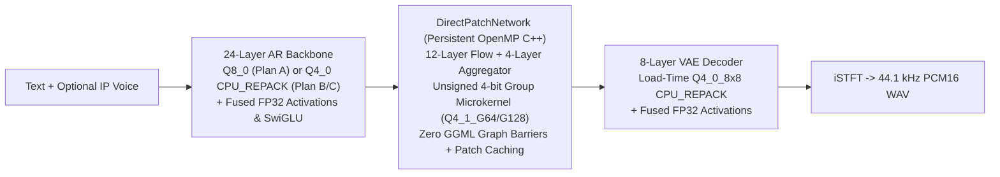

# Ming-3.0-TTS 0.5B Real-Time x86 CPU Optimization (`RTF < 1.0`)

[English](README.md) | [中文说明](README_ZH.md) | [Full Experiment Log](docs/experiments.md)

Achieving **real-time (`RTF 0.79–0.95`)** neural TTS synthesis for **Ming-3.0-TTS 0.5B** on a 6-year-old 4-core desktop CPU (**Intel Core i3-10100 @ 3.60 GHz** inside a TrueNAS Linux VM, 4 threads, no discrete GPU, no iGPU passthrough) — using the **existing official `Q8_0` GGUF checkpoint** with load-time weight repacking (~2.3s), zero swap, and up to **46% lower peak RAM**.

Built as a clean, replayable patch and C++ AVX2 microkernel suite on top of [`0xShug0/audio.cpp`](https://github.com/0xShug0/audio.cpp) (`7d20b414`, Apache 2.0) without modifying the upstream checkout.

---

## Headline ABBA Benchmark Results

All numbers below are from sequential **ABBA** comparisons (`baseline → fast → fast → baseline`, 1 warmup + 2 measured runs per block = 4 measured runs per variant) inside identical `systemd-run` resource limits (**4 threads, `CPUQuota=400%`, `MemoryMax=6G`, `MemorySwapMax=0`**). Audio hashes are verified bitwise-deterministic across repeated runs and blocks.

### 1. Three Operating Modes (Same Binary, Same `Q8_0` GGUF)

| Mode | Configuration | Short (`zh_short.txt`) Median RTF | Long Paragraph (107 chars, auto-chunked) Median RTF | `灵小柔` IP Voice (30 chars) Median RTF | Peak RSS (Long) | Notes |
| --- | --- | ---: | ---: | ---: | ---: | --- |
| **Upstream Baseline** | Unmodified `audio.cpp` (`Q8_0`, 10-step CFG=2.0) | `1.69–1.82` | `1.91–1.99` | `1.8066` | `1.98 GiB` | Reference baseline |
| **Plan A (Recommended — High Quality)** | `AR=q8` (fused FP32 act) + `Flow/Agg=q4g64` (8-step sway, full CFG) + `VAE=q4_0` | **`0.8717`** (**1.94×**) | **`0.9327`** (**2.05×**) | **`0.9525`** (**1.90×**) | **`1.25 GiB`** (-37%) | **Best listening fidelity**: `0.0000` CER across all 4 suites, `0.9539` speaker cosine on `灵小柔`, zero chunk-2 artifacts |
| **Plan B (Fastest / Lowest RAM)** | `AR=q4_0` + `Flow/Agg=q4g64` (8-step sway, full CFG) + `VAE=q4_0` | **`0.7884`** (**2.18×**) | **`0.8747`** (**2.25×**) | `0.8674`* | **`1.09 GiB`** (-45%) | Maximum RTF margin & lowest memory; `0.0000` clipping; best for single-chunk / fixed-voice workloads |
| **Plan C (Exact 10-Step Schedule)** | `AR=q4_0` + `Flow/Agg=q4g128` (exact official 10-step, full CFG) + `VAE=q4_0` | **`0.8917`** (**2.05×**) | **`0.9881`** (**2.01×**) | — | **`1.07 GiB`** (-46%) | Zero sampling schedule changes (`flow_steps=10`, full CFG=2.0 on every step) |

*\*Single-run measurement for Plan B on `灵小柔` 30-char (`CER=0.0000`, `clip=0.000000`, speaker cosine `0.8501`).*

### 2. Plan A (`AR=q8`, Recommended) Detailed ABBA & Automated Screening

| Fixture | Baseline Median RTF | Plan A Median RTF | Plan A 4-Run Distribution | Speedup | Peak RSS (Base → Plan A) | ASR CER (Base → Plan A) | CAMPPlus Speaker Cosine | Clipping |
| --- | ---: | ---: | --- | ---: | ---: | ---: | ---: | ---: |
| `zh_short.txt` (4.0s) | `1.6940` | **`0.8717`** | `0.9018, 0.8599, 0.8787, 0.8647` | **1.94×** | `1.33 → 1.24 GiB` | `0.0000 → 0.0000` | `0.8579` (uncond) | `0.000000` |
| `zh_paragraph.txt` (107 chars, 20.9s) | `1.9088` | **`0.9327`** | `0.9292, 0.9333, 0.9365, 0.9321` | **2.05×** | `1.98 → 1.25 GiB` | `0.0625 → 0.0000` | `0.8785` (uncond) | `0.000039` |
| `zh_lingxiaorou_short.txt` (`灵小柔`, 6.0s) | `1.8066` | **`0.9525`** | `0.9531, 0.9488, 0.9716, 0.9519` | **1.90×** | `1.35 → 1.24 GiB` | `0.0000 → 0.0000` | **`0.9539`** (`review_flag=false`) | `0.000000` |
| `zh_paragraph.txt` (`灵小柔`, 18.5s)¹ | `2.0229` | `1.0766`¹ | `1.0307, 1.0146, 1.1226, 1.1655` | **1.88×** | `1.97 → 1.26 GiB` | `0.0000 → 0.0000` | **`0.9166`** (`review_flag=false`) | `0.000000` |
| `zh_regression.txt` (single run) | `1.6888` | **`0.8861`** | `0.8861` | **1.91×** | `1.32 → 1.24 GiB` | — | — | — |
| `zh_long_regression.txt` (single run) | `1.8672` | **`0.9004`** | `0.9004` | **2.07×** | `1.93 → 1.25 GiB` | — | — | — |

> ¹ In pinned `audio.cpp` `7d20b414`, `灵小柔` is passed via `template_name=freeform` (bypassing the older English-only `voice_id` enum validator), which does not set `controls["ip"]` and therefore still triggers redundant chunk-1 voice anchoring on multi-chunk text plus ~55 extra JSON tokens per chunk; on newer `audio.cpp` builds with native `template_name=ip, voice_id=灵小柔`, chunk anchoring is skipped automatically.

Sanitized JSON reports for all ABBA runs and SenseVoice INT8 ASR + CAMPPlus quality screenings live in [`benchmarks/published_results/`](benchmarks/published_results/). Automated ASR/speaker metrics are screening tools, not a formal human MOS test.

---

## Audio Samples (A/B Comparisons)

Unedited 44.1 kHz PCM16 outputs from the exact ABBA runs above (hosted as [GitHub Release `audio-samples`](https://github.com/RobotSe7en/ming3-tts-cpu-realtime/releases/tag/audio-samples) assets to keep the Git repository lightweight):

| Sample | Voice & Text | A: Upstream Baseline (`Q8_0`) | B: Plan A Real-Time (`AR=q8`, `Flow=q4g64`) | Side-by-Side A/B Video | Metrics |
| --- | --- | --- | --- | --- | --- |
| **1. Short IP Voice** | Built-in `灵小柔` (30 chars, 6.0s) | [Baseline WAV](https://github.com/RobotSe7en/ming3-tts-cpu-realtime/releases/download/audio-samples/01_lingxiaorou_30c_baseline_q8.wav) (`RTF 1.81`) | [Plan A WAV](https://github.com/RobotSe7en/ming3-tts-cpu-realtime/releases/download/audio-samples/01_lingxiaorou_30c_planA_ar_q8_rtf095.wav) (**`RTF 0.95`**) | [A/B Waveform MP4](https://github.com/RobotSe7en/ming3-tts-cpu-realtime/releases/download/audio-samples/ab_demo_lingxiaorou_30c.mp4) | **1.90×**, CER `0.0000`, Cosine **`0.9539`** |
| **2. Long Paragraph (Uncond)** | Auto-chunked (107 chars, 20.9s) | [Baseline WAV](https://github.com/RobotSe7en/ming3-tts-cpu-realtime/releases/download/audio-samples/03_uncond_107c_baseline_q8.wav) (`RTF 1.91`) | [Plan A WAV](https://github.com/RobotSe7en/ming3-tts-cpu-realtime/releases/download/audio-samples/03_uncond_107c_planA_ar_q8_rtf093.wav) (**`RTF 0.93`**) | [A/B Waveform MP4](https://github.com/RobotSe7en/ming3-tts-cpu-realtime/releases/download/audio-samples/ab_demo_uncond_107c.mp4) | **2.05×**, CER `0.0000`, Peak RSS `-37%` |
| **3. Long Paragraph (`灵小柔`)** | Built-in `灵小柔` (107 chars, 18.5s) | [Baseline WAV](https://github.com/RobotSe7en/ming3-tts-cpu-realtime/releases/download/audio-samples/02_lingxiaorou_107c_baseline_q8.wav) (`RTF 2.02`) | [Plan A WAV](https://github.com/RobotSe7en/ming3-tts-cpu-realtime/releases/download/audio-samples/02_lingxiaorou_107c_planA_ar_q8.wav) (`RTF 1.08`¹) | [A/B Waveform MP4](https://github.com/RobotSe7en/ming3-tts-cpu-realtime/releases/download/audio-samples/ab_demo_lingxiaorou_107c.mp4) | **1.88×**, CER `0.0000`, Cosine **`0.9166`** |

> **Tip**: All samples were synthesized deterministically with `seed=1895`, 4 CPU threads, and zero post-processing.

---

## Why Naive Tuning Fails: Hardware Roofline & Bottlenecks

Before writing kernels, we profiled stage timings and measured raw DRAM read bandwidth on this 4-core i3-10100 VM (AVX2/FMA/F16C, no AVX-512/VNNI):

- **Stage profile (4T `Q8_0` baseline)**: Flow sampling accounts for **68.4%** of total synthesis time (500 sequential `M=6` forward passes for 4s audio), AR decode/prefill **16.4%**, VAE decoder **10.7%**, Aggregator **4.3%**.
- **Measured 4-thread DDR4 read bandwidth**: **`25.35 GB/s`**.
- **Physical floor for unmodified `Q8_0` 10-step Flow**: Reading ~179 MB of `Q8_0` Flow weights 500 times transfers `89.3 GB`, requiring **`3.52 s` (`RTF ≥ 0.88`) for Flow DRAM reads alone** — plus ~`0.50 RTF` from AR + VAE + Aggregator, making `RTF ≤ 1.0` physically impossible under pure `Q8_0` 10-step full-CFG.
- **Why iGPU (Intel UHD 630) wouldn't help**: The VM exposes only a virtual QXL adapter (no `/dev/dri/renderD*`). Even with VFIO passthrough, UHD 630 (Gen9.5, 24 EU, no DP4A/XMX) shares the same `25.35 GB/s` DDR4 bus while adding GPU submission/sync latency to 500 tiny `M=6` sequential calls.

---

## Architecture & Key Optimizations



1. **Direct Persistent C++ Flow & Aggregator Engine** ([`src/ming_cpu/flow_engine.cpp`](src/ming_cpu/flow_engine.cpp)):
   - Replaces ~200 GGML graph nodes and barriers per step with a single persistent `#pragma omp parallel` region spanning all Flow steps of a patch.
   - Precomputes `time_mlp` per timestep; caches `cond_emb`, `hist_emb`, and Block-0 `hist_qkv` once per patch; shares Block-0 `x_emb` QKV across cond/uncond (3 rows instead of 6); precomputes Aggregator `cls_qkv` once at load.
   - Fuses `RMSNorm + BF16 + Quantize` in L1 stack buffers, fuses `RoPE + Multi-Head Attention + BF16`, fuses `bias + BF16 + residual/GELU LUT`, adds 4-channel unrolled AVX2 kernels for `M=1,2`, batches Aggregator (`chunk ≤ 3`), and caches repeated `prompt_latents` projections across chunks.
2. **Group-Quantized Unsigned 4-bit AVX2 Microkernel (`Q4_1_G64` / `Q4_1_G128`)**:
   - Packs each output channel into a single 32B-aligned contiguous slab (group size 64 or 128) with unsigned 4-bit nibbles, paired with a group-major `Q8GroupInputBuffer` that eliminates 4 KiB L1d set-aliasing on `in_features=4096`.
   - Inner loop uses `vpmaddubsw + vpaddw` with zero `vpsignb` overhead (worst-case 16-bit partial sum `15,240 < 32,767`, zero overflow), cutting 12-layer `M=6` Flow latency from ~8–9 ms/step down to ~3.6–4.1 ms/step.
   - All AVX2/FMA/F16C paths are runtime-gated via `__builtin_cpu_supports` with full portable scalar fallbacks and `Q8_0` compatibility.
3. **Load-Time `CPU_REPACK` & Fused FP32 Activations** ([`src/ming_cpu/repack_weights.cpp`](src/ming_cpu/repack_weights.cpp)):
   - Parallel OpenMP load-time conversion from the verified `Q8_0` GGUF into GGML's `ggml_backend_cpu_repack_buffer_type()` (`Q4_0_8x8_q8_0`, total load ~2.3s).
   - Disables ~550 artificial intermediate BF16 rounding passes in quantized/fast CPU mode (`--fused-fp32-act 1`), unlocking fused `ggml_swiglu` even when keeping AR at lossless `Q8_0`.
4. **Uniform-`u` 8-Step Sway Schedule & Chunk-1 Anchor Latent Reuse**:
   - Fixes earlier non-uniform EPSS step failures (where the final Euler step jumped `dt = 0.707`, causing severe ASR errors) by spacing uniformly in `u` before the cosine sway transform while keeping full `CFG = 2.0` on every step.
   - For unconditioned multi-chunk text, slices Chunk 1's generated latents by exact `patch_samples = output_dim * patch_size` while still running CAMPPlus (`--reuse-anchor-latent 1`), saving ~1.0s and ~380 MiB RSS (`--reuse-anchor-latent 0` falls back to full `MingAudioEncoder`).
5. **The Listening Catch (Why Plan A Keeps `AR=q8`)**:
   - Automated ASR CER looked great on `AR=q4_0` (`CER = 0.02–0.03`), yet side-by-side listening against Apple Silicon Mac Metal outputs revealed a metallic/telephone compression artifact starting at Chunk 2 of long unconditioned passages.
   - Component-by-component isolation (`reuse=0`, `VAE=q8`, `Agg=q8`, `AR=q8`) proved **`AR=q4_0`** was the sole culprit: 4-bit AR degraded long acoustic prompt conditioning. Restoring `AR=q8` with `--fused-fp32-act 1` eliminated the artifact 100%, raised `灵小柔` speaker cosine to **`0.9539`** (`review_flag=false`), and still achieved **`RTF 0.87–0.95`**.

---

## Quick Start & Reproduction

### 1. Fetch Pinned `audio.cpp` & Verified Model Weights

```bash
git clone --depth 1 --filter=blob:none --sparse https://github.com/0xShug0/audio.cpp.git .cache/audio.cpp
git -C .cache/audio.cpp fetch --depth 1 origin 7d20b414da088c3ffe56bd8803398d9d158cb847
git -C .cache/audio.cpp checkout --detach 7d20b414da088c3ffe56bd8803398d9d158cb847
git -C .cache/audio.cpp sparse-checkout set app include src external model_specs tools webui/native/demo_voices

mkdir -p models
curl --noproxy '*' --fail --location --retry 3 \
  --output models/ming-3.0-tts-0.5b-q8_0.gguf \
  https://modelscope.cn/models/audio-cpp/Ming-3.0-TTS-0.5B-GGUF/resolve/master/ming-3.0-tts-0.5b-q8_0.gguf
# Expected size: 1742280896 bytes
# Expected SHA-256: fcf2aa25e8e9cf2065a936e506581735c64d6255fb7869f09fbb61a2dde09aa1
```

### 2. Apply Patch, Build & Run Parity Tests

```bash
git -C .cache/audio.cpp worktree add --no-checkout --detach "$PWD/.cache/audio.cpp-ming-fast" HEAD
git -C .cache/audio.cpp-ming-fast sparse-checkout set app include src external model_specs tools webui/native/demo_voices
git -C .cache/audio.cpp-ming-fast checkout --detach HEAD
git -C .cache/audio.cpp-ming-fast apply "$PWD/src/patches/ming_fast_cpu.patch"

cmake -S benchmarks -B .cache/bench-build -DCMAKE_BUILD_TYPE=Release \
  -DTTS_BUILD_MING_ENGINE=ON -DTTS_BUILD_MING_FAST=ON -DTTS_BUILD_MING_PROFILE=ON
cmake --build .cache/bench-build --target ming3_rtf ming3_fast_rtf ming3_fast_profile_rtf ming3_fast_engine_test -j 2
ctest --test-dir .cache/bench-build --output-on-failure
```

### 3. Run ABBA Benchmarks

```bash
# Plan A (Recommended: AR=q8 + fused FP32 act + Flow/Agg=q4g64 8-step + VAE=q4_0)
python3 benchmarks/compare_ming_fast.py --fixture zh_short.txt --iterations 2 --threads 4 --reference baseline \
  --flow-quant q4g64 --agg-quant q4g64 --ar-quant q8 --vae-quant q4_0 --fused-fp32-act 1 --flow-steps 8 --cfg-interval 1
python3 benchmarks/compare_ming_fast.py --fixture zh_paragraph.txt --iterations 2 --threads 4 --reference baseline \
  --flow-quant q4g64 --agg-quant q4g64 --ar-quant q8 --vae-quant q4_0 --fused-fp32-act 1 --flow-steps 8 --cfg-interval 1 --skip-regressions

# Plan A with built-in IP voice 灵小柔
INSTRUCT='{"audio_sequence": [{"序号": 1, "说话人": "speaker_1", "方言": null, "风格": null, "语速": null, "基频": null, "音量": null, "情感": null, "BGM": {"Genre": null, "Mood": null, "Instrument": null, "Theme": null, "ENV": null, "SNR": null}, "IP": "灵小柔"}]}'
python3 benchmarks/compare_ming_fast.py --fixture zh_lingxiaorou_short.txt --iterations 2 --threads 4 --reference baseline \
  --flow-quant q4g64 --agg-quant q4g64 --ar-quant q8 --vae-quant q4_0 --fused-fp32-act 1 --flow-steps 8 --cfg-interval 1 \
  --template-name freeform --instruct "$INSTRUCT" --tag-suffix lingxiaorou --skip-regressions

# Plan B (Fastest / Lowest RAM: AR=q4_0 + Flow/Agg=q4g64 8-step + VAE=q4_0)
python3 benchmarks/compare_ming_fast.py --fixture zh_paragraph.txt --iterations 2 --threads 4 --reference baseline \
  --flow-quant q4g64 --ar-quant q4_0 --vae-quant q4_0 --flow-steps 8 --cfg-interval 1 --skip-regressions

# Plan C (Exact 10-Step Schedule: AR=q4_0 + Flow/Agg=q4g128 10-step + VAE=q4_0)
python3 benchmarks/compare_ming_fast.py --fixture zh_paragraph.txt --iterations 2 --threads 4 --reference baseline \
  --flow-quant q4g128 --ar-quant q4_0 --vae-quant q4_0 --flow-steps 10 --cfg-interval 1 --skip-regressions
```

---

## Repository Structure

```text
├── src/
│   ├── ming_cpu/
│   │   ├── flow_engine.{h,cpp}      # Persistent OpenMP C++ Flow/Aggregator + Q4_1_G64/G128 AVX2 kernels
│   │   ├── repack_weights.{h,cpp}   # Parallel load-time CPU_REPACK (Q4_0/IQ4_NL/F16) + fused FP32 act
│   │   └── kernels.{h,cpp}          # Earlier Q8_0 BF16 GELU LUT & parity helpers
│   └── patches/
│       └── ming_fast_cpu.patch      # Replayable 5-file patch against audio.cpp 7d20b414
├── tests/
│   └── ming_fast_engine_test.cpp    # CTest AVX2-vs-scalar parity, F32 cosine, and time-grid checks
├── benchmarks/
│   ├── CMakeLists.txt               # Builds baseline, profiled, and fast targets
│   ├── ming3_rtf.cpp                # Resource-isolated C++ timing harness
│   ├── run_tts.py / run_ming3.py    # systemd-run cgroup monitor (CPU/RSS/swap/steal)
│   ├── compare_ming_fast.py         # Alternating ABBA comparison & WAV hash validator
│   ├── assess_ming_audio.py         # Local SenseVoice INT8 ASR + CAMPPlus quality screener
│   ├── published_results/           # Sanitized ABBA & quality screening JSON summaries
│   └── zh_*.txt                     # Chinese short, regression, paragraph, and 灵小柔 fixtures
└── docs/
    └── experiments.md               # Complete chronological log of baselines & intermediate experiments
```

## License & Acknowledgments

Licensed under the [Apache License 2.0](LICENSE). Built on [`0xShug0/audio.cpp`](https://github.com/0xShug0/audio.cpp) (`ggml`) and [`inclusionAI/Ming-3.0-TTS-0.5B`](https://modelscope.cn/models/audio-cpp/Ming-3.0-TTS-0.5B-GGUF).
